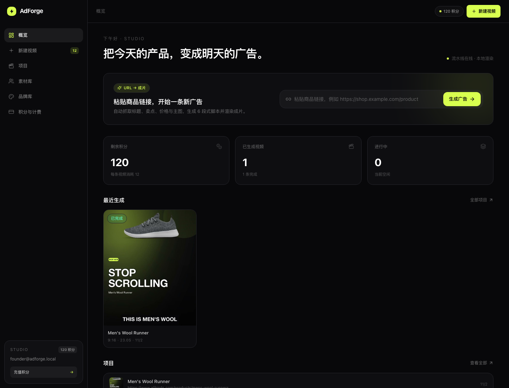
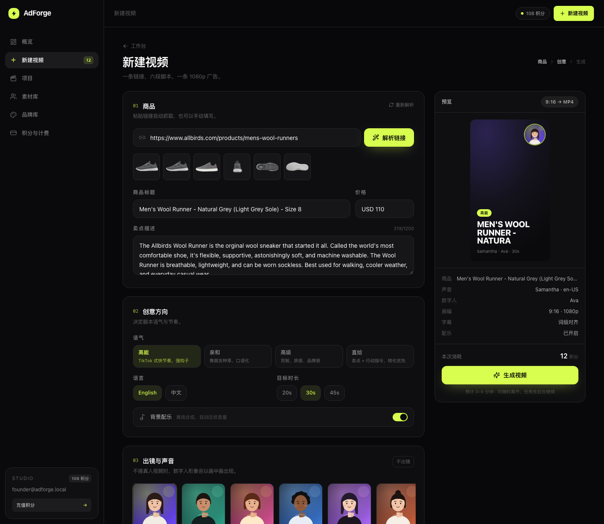
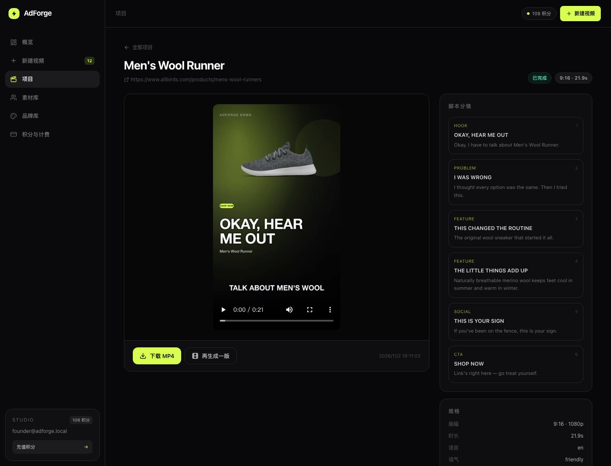

# AdForge

**把一条商品链接，变成能投的短视频广告。**

AdForge 是一个可本地运行的全自动广告产线：抓取商品页 → 生成五段式脚本 → 合成配音与词级字幕 → 排版画面 → FFmpeg 输出 1080p 成片。提供完整的工作台、项目管理和品牌库。

> 产品形态参考 Creatify.ai，代码、界面与视觉均为原创实现，未使用其任何代码或素材。


## 目录

- [它是什么 / 不是什么](#它是什么--不是什么)
- [功能](#功能)
- [架构](#架构)
- [技术栈](#技术栈)
- [快速开始](#快速开始)
- [环境变量](#环境变量)
- [目录结构](#目录结构)
- [渲染流水线](#渲染流水线)
- [API](#api)
- [数据与存储](#数据与存储)
- [开发脚本](#开发脚本)
- [性能与内存](#性能与内存)
- [已知限制](#已知限制)
- [排障](#排障)
- [合规声明](#合规声明)

## 它是什么 / 不是什么

**是**：一条可跑通的 URL → 成片流水线，包含抓取、脚本、TTS、字幕、画面排版、渲染、任务队列、进度推送和项目管理。

**不是**：

- 不是 Creatify 的像素级复刻，也不是它的代理或分支
- 不是数字人口型合成器：内置形象是矢量占位，接 HeyGen / D-ID 后才是真人口播
- 不是生产级 SaaS：没有登录鉴权、支付、多租户和并发隔离

## 功能

- **URL 解析**：JSON-LD / OpenGraph / meta / `img srcset`，JS 渲染页自动降级到系统 Chrome `--dump-dom`
- **五段式脚本**：钩子 → 痛点 → 卖点 → 收益 → 行动；4 种语气（高能 / 亲和 / 高级 / 直给），中英双语
- **脚本引擎可替换**：默认离线模板；配置 `OPENAI_API_KEY` 后自动改用大模型写稿并做结构校验
- **配音**：macOS `say` 9 个声音（美/英/澳/爱/印/南非/普通话/台湾腔/粤语），生成词级时间轴；可选 OpenAI TTS
- **画面**：`sharp` 排版，透明商品图自动抠图、商品卡片、数字人画中画、品牌色渐变、渐变遮罩、运镜
- **字幕**：按词分组、逐句出现，带统一宽度约束，避免溢出
- **渲染**：FFmpeg `zoompan` + 叠加 + 拼接 + 响度归一化 + 离线合成配乐 + AAC 混音
- **多画幅**：9:16 / 1:1 / 16:9，1080p 输出
- **任务队列**：SQLite 任务表 + 独立 worker 轮询，失败自动重试一次，进度落库
- **实时进度**：SSE + 轮询兜底，离开页面任务继续
- **品牌库**：品牌色、CTA、域名进入每一帧
- **积分账本**：每条视频 12 积分，本地演示，不接支付

## 架构

```
┌──────────────┐        POST /api/videos         ┌────────────────────┐
│   Browser    │ ──────────────────────────────► │  Next.js 15 (3100) │
│  React 19    │ ◄──── SSE /api/videos/:id ───── │  Route Handlers    │
└──────────────┘                                 └─────────┬──────────┘
                                                           │ 写库
                                                           ▼
                                                 ┌────────────────────┐
                                                 │ SQLite (node:sqlite)│
                                                 │ var/adforge.db      │
                                                 └─────────┬──────────┘
                                                           │ 轮询 jobs
                                                           ▼
                                                 ┌────────────────────┐
                                                 │ worker (tsx)       │
                                                 │ processVideo()     │
                                                 └─────────┬──────────┘
                                                           │
        ┌──────────────┬──────────────┬────────────────────┼──────────────┐
        ▼              ▼              ▼                    ▼              ▼
   抓取/解析       脚本生成        配音 TTS            画面排版        FFmpeg
  fetch+cheerio   模板 / LLM     say / OpenAI        sharp/SVG     渲染 + 混音
```

## 技术栈

| 层 | 选型 |
|---|---|
| 语言 | TypeScript（全栈统一） |
| 运行时 | Node.js 22（依赖内置 `node:sqlite`） |
| 前端 | Next.js 15 App Router、React 19、Tailwind CSS v4、lucide-react |
| 服务端 | Next.js Route Handlers（Node runtime） |
| Worker | `tsx` 独立进程 |
| 数据库 | SQLite（`node:sqlite`，WAL） |
| 图像 | `sharp`（libvips） |
| 视频 | 系统 FFmpeg 9 / ffprobe（H.264 + AAC） |
| 配音 | macOS `say`；可选 OpenAI TTS |
| 解析 | `cheerio`；可选系统 Chrome headless |
| 校验 | `zod` |

## 界面

| 工作台 | 创建向导 |
| --- | --- |
| \ | \ |

\

## 快速开始

### 依赖

- **Node.js ≥ 22.5**（`node:sqlite` 需要）；开发环境使用 22.22
- **pnpm**（仓库使用 pnpm 10）
- **FFmpeg / ffprobe**：需要 `libx264` 与 AAC 编码器（Homebrew 默认构建即可）
- **macOS**：默认配音依赖系统 `say`；Linux 请改用 `ADFORGE_TTS=openai` + API Key
- **Google Chrome**（可选）：仅在抓取 JS 渲染页面时作为兜底

```bash
# macOS
brew install ffmpeg
```

### 安装与运行

```bash
pnpm install
pnpm dev
```

打开 **http://localhost:3100**。

> 默认端口是 3100（很多机器 3000 已被占用）。改端口请编辑 `package.json` 里的 `dev` / `start`。

`pnpm dev` 会同时启动：

1. `next dev -p 3100` — Web 与 API
2. `tsx watch worker.ts` — 渲染 worker

### 生产模式

```bash
pnpm build
pnpm start        # 仍需单独启动 worker：pnpm worker
```

### 重置数据

```bash
rm -rf var        # 删除数据库与所有成片，下次启动自动重建并发放 120 积分
```

### 生成一条示例成片（无需打开页面）

```bash
pnpm exec tsx scripts/render-demo.ts
pnpm exec tsx scripts/render-demo.ts --zh          # 中文
pnpm exec tsx scripts/render-demo.ts --square      # 1:1
pnpm exec tsx scripts/render-demo.ts --wide        # 16:9
```

脚本会直接建项目并跑完整流水线，不扣积分，用于开发调试。

## 环境变量

全部可选；不配置也能完整跑通。

| 变量 | 作用 | 默认 |
|---|---|---|
| `OPENAI_API_KEY` | 启用大模型写稿；同时启用 OpenAI TTS | 未设置 |
| `OPENAI_BASE_URL` | OpenAI 兼容网关 | `https://api.openai.com/v1` |
| `ADFORGE_LLM_MODEL` | 写稿模型 | `gpt-4o-mini` |
| `ADFORGE_TTS` | 设为 `openai` 强制使用 OpenAI TTS | 自动判断 |
| `ADFORGE_TTS_MODEL` | TTS 模型 | `gpt-4o-mini-tts` |
| `ADFORGE_TTS_VOICE` | TTS 音色 | `alloy` |
| `ADFORGE_DATA_DIR` | 数据目录（数据库 + 媒体） | `./var` |
| `CHROME_PATH` | Chrome 可执行文件路径 | macOS 默认安装路径 |
| `ADFORGE_DEBUG` | 输出流水线日志 | 关闭 |

> LLM 或 TTS 调用失败会自动回退到离线模板 / `say`，不会中断出片。

## 目录结构

```
.
├── src/
│   ├── app/
│   │   ├── page.tsx                  # 落地页
│   │   ├── studio/                   # 工作台（概览/创建/项目/素材/品牌/计费）
│   │   └── api/                      # Route Handlers
│   ├── components/                   # UI 组件、侧边栏、品牌编辑器
│   └── lib/
│       ├── providers/
│       │   ├── scrape.ts             # 商品抓取与解析
│       │   ├── llm.ts                # 脚本生成（模板 + 大模型）
│       │   └── tts.ts                # 配音（say + OpenAI）
│       ├── pipeline/
│       │   ├── index.ts              # processVideo 总编排
│       │   ├── stills.ts             # 画面排版（sharp/SVG）
│       │   ├── captions.ts           # 字幕分组与渲染
│       │   ├── audio.ts              # 补静音、拼接、混音
│       │   ├── music.ts              # 离线配乐合成
│       │   └── render.ts             # FFmpeg 片段/拼接/封装
│       ├── db.ts                     # SQLite 初始化与查询
│       ├── types.ts                  # 共享类型
│       ├── voices.ts / avatars.ts    # 声音与数字人
│       └── ffmpeg.ts                 # ffmpeg/ffprobe/download 封装
├── scripts/render-demo.ts            # 直接跑流水线的开发脚本
├── worker.ts                         # 任务轮询进程
├── var/                              # 运行时生成：数据库 + 媒体（已 gitignore）
└── docs/screenshots/
```

## 渲染流水线

`processVideo(videoId)`（`src/lib/pipeline/index.ts`）按阶段推进并写回进度：

1. **解析素材（6%）** `analyzing`
   下载商品图（校验尺寸与格式），渲染数字人 PNG，读取图片 alpha 判断是否为抠图素材。

2. **生成脚本（16–26%）** `scripting`
   模板或大模型产出 6 个场景：`hook / problem / feature / benefit / social / cta`，每个场景包含口播文案、屏幕标题、副标题和配图。

3. **配音（28–60%）** `voicing`
   逐场景调用 TTS，拿到音频时长；按字符权重估算词级时间轴；补 0.35s 前导与 0.55s 尾巴，形成场景时长。

4. **排版画面（62–78%）** `assembling`
   每个场景生成一张 1080p 静帧：
   - `hook`：商品抠图 + 渐变背景 + 大标题
   - `problem`：纯文字版式 + 品牌色高亮
   - `feature / benefit`：标题 + 商品卡片 + 数字人画中画
   - `social`：浅色引用版式
   - `cta`：品牌色满版 + CTA 药丸
   同时生成逐句字幕 PNG。

5. **渲染（80–94%）** `rendering`
   每个场景：`zoompan` 运镜 + 字幕按时间叠加 → H.264 片段；再 concat、拼接配音、混入配乐、AAC 封装。

6. **完成（100%）**
   输出 `final.mp4` 与 `thumb.jpg`，更新项目封面。

> 文字为什么不用 `drawtext`/`subtitles`？很多 FFmpeg 构建没有 libass/libfreetype。AdForge 把所有文字用 `sharp`（SVG）渲染成图层，再由 FFmpeg 合成，字体与排版完全可控。

## API

| 方法 | 路径 | 说明 |
|---|---|---|
| GET | `/api/health` | 进程内存、uptime、Node 版本 |
| GET | `/api/dashboard` | 概览数据（项目、最近视频、积分） |
| POST | `/api/analyze` | 解析商品链接，返回标题/描述/图片/价格 |
| POST | `/api/videos` | 创建视频任务（扣 12 积分） |
| GET | `/api/videos/:id` | 视频状态、脚本、成片地址 |
| GET | `/api/videos/:id/events` | SSE 实时进度 |
| POST | `/api/videos/:id/retry` | 重新入队 |
| GET | `/api/media/*` | 媒体文件，支持 Range（视频拖动） |
| GET | `/api/voices` | 声音列表 |
| GET | `/api/voices/:id/preview` | 即时合成试听 MP3 |
| GET | `/api/avatars` | 数字人列表 |
| GET | `/api/avatars/:id/image` | 数字人头像 PNG |
| GET / PUT | `/api/brand` | 品牌库读取 / 保存 |
| GET | `/api/projects` | 项目列表（含视频） |
| GET | `/api/projects/:id` | 单项目详情 |

创建视频示例：

```bash
curl -X POST http://localhost:3100/api/videos \
  -H 'Content-Type: application/json' \
  -d '{
    "product": {
      "url": "https://shop.example.com/products/xxx",
      "title": "Wool Runner",
      "description": "Naturally breathable merino wool...",
      "images": ["https://shop.example.com/img/1.png"],
      "price": "USD 110"
    },
    "voiceId": "samantha",
    "avatarId": "ava",
    "aspect": "9:16",
    "tone": "energetic",
    "language": "en",
    "music": true,
    "duration": 30
  }'
```

## 数据与存储

| 路径 | 内容 |
|---|---|
| `var/adforge.db` | SQLite：projects / videos / jobs / brands / profile |
| `var/media/videos/<id>/` | 静帧、字幕、音频、`final.mp4`、`thumb.jpg` |
| `var/media/videos/<id>/images/` | 下载的商品图 |
| `var/assets/avatars/` | 数字人缓存图 |
| `var/assets/voice-previews/` | 声音试听缓存 |

媒体通过 `/api/media/<相对 media 的路径>` 提供，支持 HTTP Range。

## 开发脚本

| 命令 | 说明 |
|---|---|
| `pnpm dev` | Next dev（3100）+ worker（watch） |
| `pnpm worker` | 只启动 worker |
| `pnpm build` | 生产构建 |
| `pnpm start` | 生产服务（需另开 worker） |
| `pnpm typecheck` | TypeScript 检查 |
| `pnpm exec tsx scripts/render-demo.ts` | 直接跑一条示例成片 |

## 性能与内存

在本机（Apple Silicon / macOS 26 / 1080p / 单 worker）实测：

| 指标 | 数值 |
|---|---|
| 23s 成片生成耗时 | 约 20–40s |
| 成片体积 | 1.8–3.0 MB |
| 生产服务器 RSS | 160–230 MB |
| 开发服务器 RSS | 450–600 MB |
| Worker 空闲 | 约 100 MB |
| Worker 峰值 | 240–275 MB |
| 单个 FFmpeg 片段峰值 | 约 600 MB |
| 单条视频端到端峰值 | 约 1.0–1.1 GB |

并发说明：当前是单 worker 串行渲染，多开一路大约再加 700MB。要提升吞吐，建议给 worker 加并发上限并把渲染拆到独立机器。

## 已知限制

- **数字人没有口型**：内置 8 个矢量形象，只做画中画/占位；接 HeyGen、D-ID 等只需替换 `providers/` 的实现
- **单机单 worker + SQLite**：没有分布式队列与多租户隔离
- **计费是本地演示账本**：没有接支付、没有对账
- **未做**：批量生成、竞品分析 Ad Agent、开放 API 鉴权、团队协作、素材上传
- **抓取是尽力而为**：强反爬/登录墙页面可能失败；`--dump-dom` 兜底也依赖 Chrome 可被沙箱允许启动
- **16:9** 与 9:16/1:1 共用同一套布局比例逻辑，9:16 和 1:1 已实测，16:9 未单独做视觉验收

## 排障

**端口被占用**

```bash
lsof -nP -iTCP:3100 -sTCP:LISTEN
lsof -ti tcp:3100 | xargs kill -9
```

**页面变成无样式 HTML / 500，提示 `.next/...manifest` 不存在**

通常是 `next dev` 运行期间又执行了 `next build`，两者共用 `.next` 互相覆盖。处理：

```bash
pkill -f "next dev" ; pkill -f "tsx watch worker.ts"
rm -rf .next
pnpm dev
```

**配音没声音**

确认系统有对应语音：`say -v '?' | grep Tingting`。缺失时会自动回退到系统默认声音。

**抓取失败**

先看是不是 JS 渲染页：设置 `ADFORGE_DEBUG=1` 观察日志；确认 `CHROME_PATH` 指向可执行的 Chrome。

**SSE 不更新**

前端同时有 2.5s 轮询兜底；直连 `curl -N http://localhost:3100/api/videos/<id>/events` 可验证。

## 合规声明

- 抓取第三方页面、下载图片、使用生成内容投放广告，需自行确认符合目标站点条款、版权与平台广告政策。
- 请只处理你拥有或已获授权的内容；不要用本项目批量抓取受版权保护的视频或素材。
- 生成文案为模板/模型产出，投放前请人工审核，避免虚假宣传与未经证实的功效表述。

---

未附开源许可证。如需对外发布，请自行补充 LICENSE。
